# claude-code-mods

A few mods for Claude Code that I use every day. They work in the terminal and in the desktop app.



## Install

From a shell:

```
claude plugin marketplace add dante32683/claude-code-mods
claude plugin install agent-crabs@dante32683-mods
```

Swap `agent-crabs` for any mod below. In the desktop app, click + next to the prompt box, then Plugins, add the marketplace `dante32683/claude-code-mods`, and pick the mods you want.

Mods load when a chat starts, so open a new chat after installing.

## Mods

### agent-crabs

A little Clawd above the prompt for each subagent that's running, with what it's doing right now. The crab acts it out: reading a book, walking around with a magnifying glass while it searches, writing on paper while it edits, jogging while a command runs, holding a globe while it's on the web, and thinking in between. It throws confetti when the subagent finishes and sits under a rain cloud if it fails. `/crabs-demo` plays every animation.

The animated crabs show in the desktop app; the terminal gets a small text crab.

### usage-context

A pane with your plan's 5-hour and weekly usage, how fast you're using it, how much per hour or day you can spend and still make the reset, and what's filling the context window. While the pane is closed, the usage bars sit above the prompt. `/meter` shows or hides the pane. It saves the last reading to `statusline-limits.json` in your Claude folder.

### compact-plus

Better compaction. Before each compaction it saves the whole conversation to a searchable file in `~/.claude/compact-history/` and tells Claude where it is, so details the summary drops can still be found. Your own messages are kept word for word, the summary is written as a handoff, instruction files are re-read afterward, and when a turn ends close to the auto-compact limit it compacts right away instead of mid-task. History older than 30 days is deleted. Options: `turnEndPercent` and `verbatimUserTokens`.

### repo-peers

Tells Claude when other Claude chats are working in the same repo (same checkout or another worktree) and which files they've edited, so it can coordinate before work collides. Windows only for now.

### aside

`/aside <task>` hands a side task to a background worker while your chat keeps going. Unlike `/btw`, the worker has tools. It sees the last few messages for context, and its answer opens in a pane where you can send it to the chat or dismiss it. Haiku by default; `/aside opus: <task>` uses Opus.

### bash-fixes

Windows Git Bash only. It fixes a few ways Claude's Bash tool breaks there: very long commands get cut off or mangled, `rg` patterns starting with `/` get turned into Windows paths, `sed -i` doesn't say when nothing changed, and `rm "${DIR:?}"/...` keeps asking for approval.

## Development

`./check.sh` validates every mod and runs its tests; `./check.sh bash-fixes` checks one.

## Credits

agent-crabs takes its idea from [hamzafer's agent-radar](https://github.com/hamzafer/claude-code-mods) (MIT), and Clawd's shape from Codrops' article on reverse-engineering Claude's mascot animations. Clawd is Anthropic's mascot; this is a fan project, not affiliated with Anthropic. compact-plus's summary style is modeled on OpenAI's Codex CLI.

## License

MIT
