# claude-code-mods

A few mods for Claude Code that I use every day. They work in the terminal and in the desktop app.



## Install

From a shell:

```
claude plugin marketplace add dante32683/claude-code-mods
claude plugin install agent-crabs@dante32683-mods
```

Swap `agent-crabs` for any mod below. In the desktop app, click + next to the prompt box, then Plugins, add the marketplace `dante32683/claude-code-mods`, and pick the mods you want.

Mods load when a chat starts, so open a new chat after installing.

## Mods

### agent-crabs

A little Clawd above the prompt for each subagent that's running, with what it's doing right now. The crab acts it out: reading a book, walking around with a magnifying glass while it searches, writing on paper while it edits, jogging while a command runs, holding a globe while it's on the web, and thinking in between. It throws confetti when the subagent finishes and sits under a rain cloud if it fails. `/crabs-demo` plays every animation.

The animated crabs show in the desktop app; the terminal gets a small text crab.

### usage-context

Usage bars above the prompt for your plan's 5-hour and weekly limits: how much you've used, how fast you're using it, and how much per hour or day you can spend and still make the reset. The **Stats** button at the right end of the first row opens a side pane with:

- tokens (input, output, cache reads and writes) and API-priced cost for this 5-hour window, today, this week, and the last 30 days, plus a list of the last 7 days;
- estimates learned from finished windows: how much of the weekly limit one full 5-hour window uses, what 1% of each limit buys in tokens and dollars, and where 5-hour windows usually end;
- this week's model mix;
- what's filling the context window, by category, with the memory files, MCP tools, agents, and skills behind it.

`/meter` shows or hides the pane. The token log counts only Claude Code's own requests, so chat and phone use, which count toward the same limits, aren't in it. It's kept per account (each `CLAUDE_CONFIG_DIR` separately) in the plugin store for 35 days. The last limits reading is saved to `statusline-limits.json` in your Claude folder.

### compact-plus

Better compaction. Before each compaction it saves a searchable history file in `~/.claude/compact-history/`. Tool inputs are capped at 2,000 characters and tool results at 12,000; the original `.jsonl` transcript retains full tool payloads. Recent user messages may also be kept word for word in the summary, capped at 8,000 characters each and by the `verbatimUserTokens` budget in total. Use the transcript for full long messages and tool payloads. The summary is written as a handoff, instruction files are re-read afterward, and when a turn ends close to the auto-compact limit it compacts right away instead of mid-task. History older than 30 days is deleted. Options: `turnEndPercent` and `verbatimUserTokens`.

### repo-peers

Tells Claude when other Claude chats are working in the same repo (same checkout or another worktree) and which files they've edited (including files Bash writes through `edits` or `cat >`), so it can coordinate before work collides. The note is one line per peer: working or idle, whether it's a new chat, and its three latest files (temp files left out; files you also edited are listed in full). A chat that starts working while yours is mid-task, or one that started and finished in between, is named right away, not at your next message. Windows only for now.

### aside

`/aside <task>` hands a side task to a background worker while your chat keeps going. Unlike `/btw`, the worker has tools. It sees the last few messages for context, and its answer opens in a pane where you can send it to the chat or dismiss it. Haiku by default; `/aside opus: <task>` uses Opus.

### bash-fixes

Windows Git Bash only. It fixes a few ways Claude's Bash tool breaks there: very long commands get cut off or mangled, arguments starting with `/` get turned into Windows paths (`rg` patterns, `gh api` endpoints like `/repos/x`, phone paths like `/sdcard` in `adb`, and `/switches` for `powercfg`, `schtasks`, `reg`, and other Windows tools), a bare `rg pattern` that waits forever on the tool's open stdin, `sed -i` doesn't say when nothing changed, and `rm "${DIR:?}"/...` keeps asking for approval. It also stops a `git commit` from running after a failed check or edit earlier in the same command (pipefail where a pipe gates the rest, and `bash -e` for multi-line commands, since the tool's own shell ignores `set -e`).

It adds an `edits` command for exact-text edits from a heredoc: nothing is written unless every edit matches, each file keeps its line endings, a `--- from` / `--- until` range replaces a block without retyping it, and a miss says why (whitespace, blank lines, invisible or private-use characters shown as `<U+XXXX>`, the nearest line) and keeps the input for `edits --retry`. Range runs save an `edits --undo`.

It refuses a few commands that go wrong quietly, saying what to run instead:

- a `$` inside a double-quoted `pwsh -Command` body, which Bash expands first;
- an inline `python` or `node` script that rewrites a file with `replace` or slicing (use `edits`, or put `[script-edit]` in the description);
- a Monitor or background job built on `tail -f` with no end, which outlives what it watches;
- a job detached with a trailing `&` or `nohup`, which outlives the call's hidden console so that every console program it starts later opens a terminal window (use `run_in_background`, or end the command with `wait`);
- with `repo-peers` installed, git commands that can throw away another chat's uncommitted work (`stash`, `--autostash`, `reset --hard`, a merge or pull that isn't a fast-forward, checking out paths this chat didn't write) in a checkout where another chat is working; `[git-solo]` in the description skips it.

In the Desktop app, a command that writes `HKCU` gets a note: the app is an MSIX package, so those writes land in its private registry, and the note gives the `explorer.exe` route that writes the real one.

## Development

`./check.sh` validates every mod and runs its tests; `./check.sh bash-fixes` checks one.

## Credits

agent-crabs takes its idea from [hamzafer's agent-radar](https://github.com/hamzafer/claude-code-mods) (MIT), and Clawd's shape from Codrops' article on reverse-engineering Claude's mascot animations. Clawd is Anthropic's mascot; this is a fan project, not affiliated with Anthropic. compact-plus's summary style is modeled on OpenAI's Codex CLI.

## License

MIT
